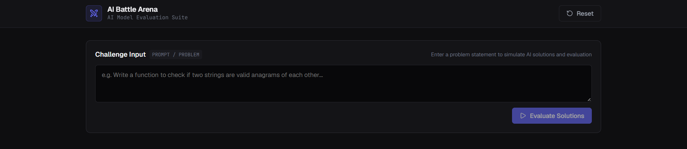
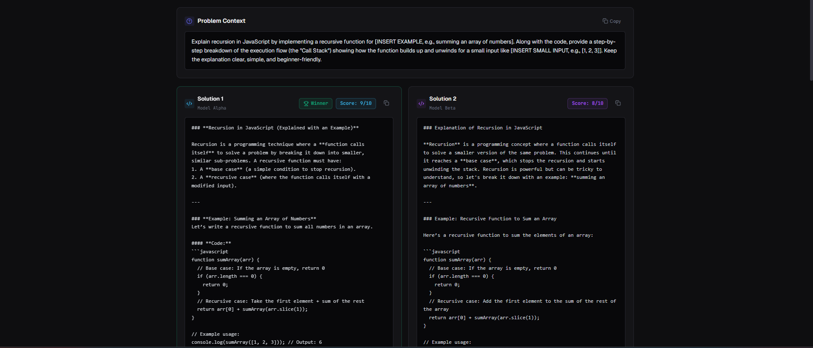
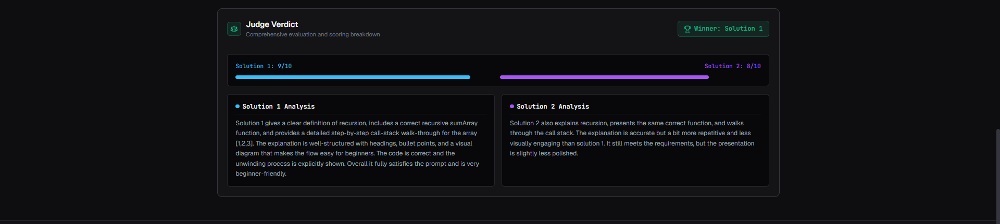

# AI Battle Arena

AI Battle Arena is a full-stack application for comparing two AI-generated answers to a programming or open-ended problem. The backend asks Mistral and Cohere for solutions, then asks a Groq-hosted model to score both answers and explain its judgment. The React interface displays the problem, both solutions, and the verdict.

## Features

- Submit a problem statement from the web interface.
- Generate two independent responses: Solution 1 from Mistral and Solution 2 from Cohere.
- Evaluate both responses with a Groq model, with scores from 0 to 10 and written reasoning.
- Compare scores, see the winner, and copy the problem or either solution.
- Persist the most recent result in browser local storage; use **Reset** to clear it.
- Keep the results hidden until a problem has been returned by the backend.

## Screenshots





## Project structure

```text
Backend/
  server.ts                 Express server entry point
  src/
    app.ts                  Health and invoke API routes, CORS configuration
    ai/
      graph.ai.ts           LangGraph solution and judge workflow
      model.ai.ts           Mistral, Cohere, and Groq model clients
    config/config.ts        Loads provider keys from environment
Frontend/
  src/
    main.jsx                React entry point
    app/
      App.jsx               App state and backend request
      App.css               Application styles
      components/           Input, solution, problem, verdict, and navbar UI
```

## Requirements

- Node.js and npm
- API keys for Mistral, Cohere, and Groq

## Setup

### 1. Configure the backend

Create `Backend/.env` and add your provider API keys:

```dotenv
MISTRAL_API_KEY=your_mistral_api_key
COHERE_API_KEY=your_cohere_api_key
GROQ_API_KEY=your_groq_api_key
```

Install dependencies and start the backend:

```bash
cd Backend
npm install
npm run dev
```

The API listens on `http://localhost:3000`.

### 2. Start the frontend

In another terminal:

```bash
cd Frontend
npm install
npm run dev
```

Open the Vite URL shown in the terminal (by default, `http://localhost:5173`). The backend currently allows browser requests from that default origin.

## How it works

1. Enter a problem statement and submit it in the frontend.
2. The frontend sends it to `POST http://localhost:3000/invoke`.
3. The backend runs a LangGraph workflow: Mistral and Cohere generate solutions in parallel, then Groq evaluates both.
4. The frontend displays the problem, solution cards, scores, winner, and judge reasoning. The result is saved to local storage and restored on reload.
5. Select **Reset** in the navbar to clear the displayed result and its saved copy.

## API

### `GET /health`

Returns a service status response:

```json
{
  "message": "the service is runninng"
}
```

### `POST /invoke`

Request body:

```json
{
  "input": "Write a function to check whether two strings are anagrams."
}
```

Successful responses contain `success: true` and a `result` object with this shape:

```json
{
  "message": "The Graph executed successfully",
  "success": true,
  "result": {
    "problem": "Write a function to check whether two strings are anagrams.",
    "solution_1": "Solution generated by Mistral",
    "solution_2": "Solution generated by Cohere",
    "judge": {
      "solution_1_score": 8,
      "solution_2_score": 9,
      "solution_1_reasoning": "Reasoning for Solution 1",
      "solution_2_reasoning": "Reasoning for Solution 2"
    }
  }
}
```

Scores are numeric values from 0 to 10.

## Development commands

From `Frontend/`:

```bash
npm run dev       # Start the Vite development server
npm run build     # Build the frontend for production
npm run preview   # Preview the production build
npm run lint      # Run ESLint
```

From `Backend/`:

```bash
npm run dev       # Run the API with tsx watch
```